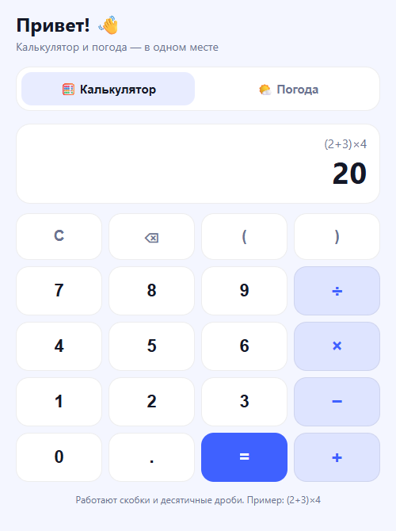
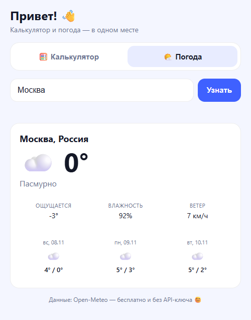
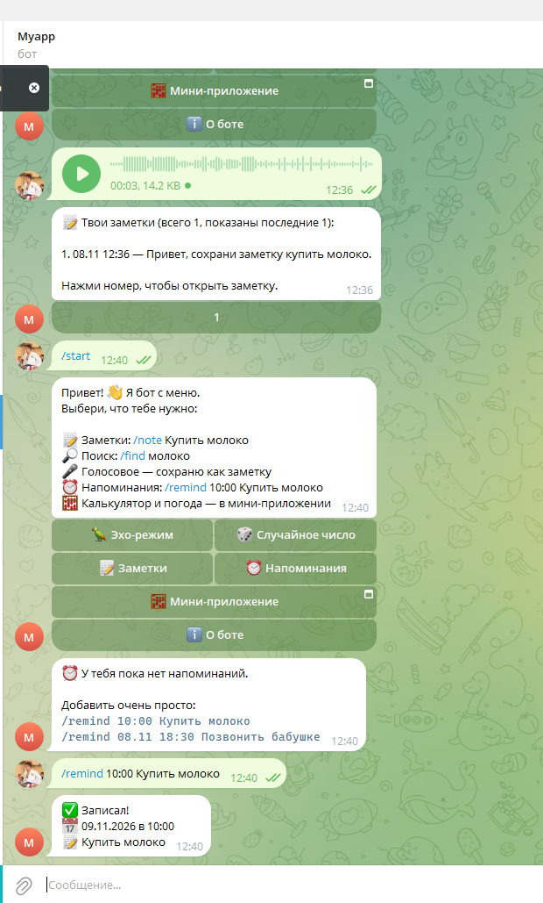
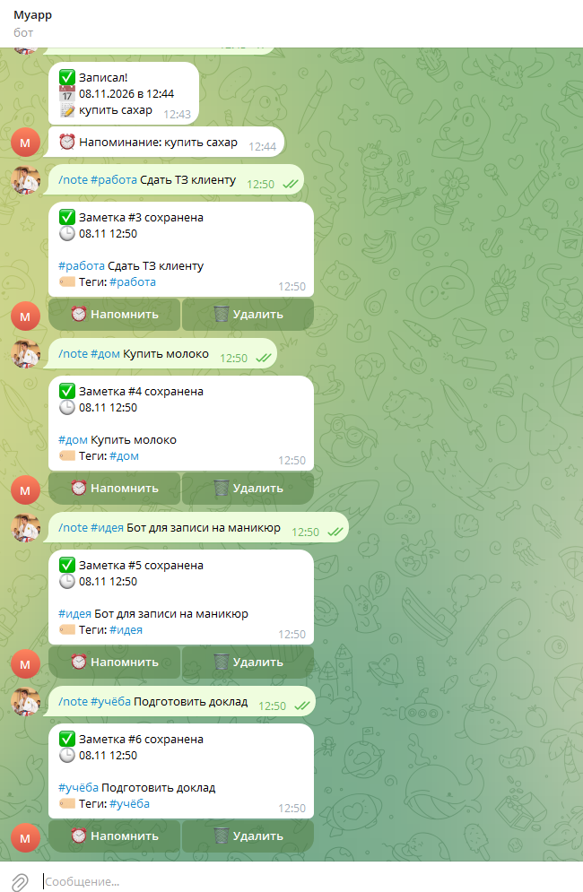
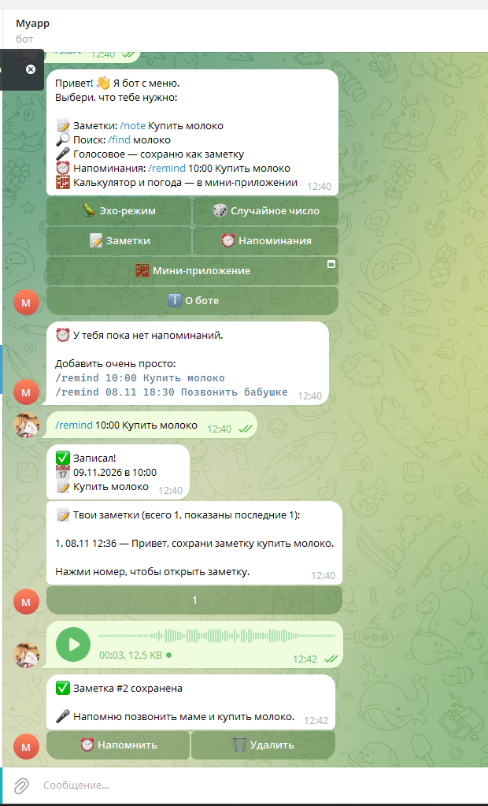
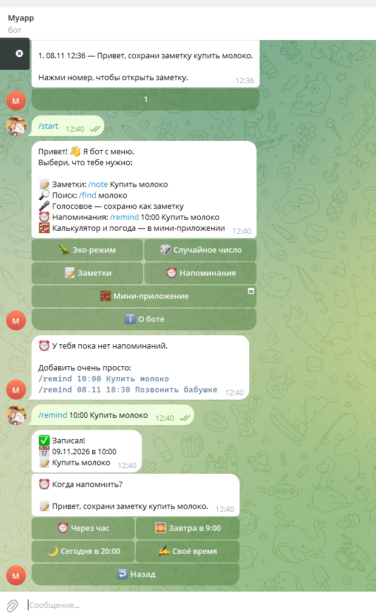

# Telegram-бот: заметки, напоминания и Mini App

Telegram-бот на Python, который заменяет сразу несколько приложений: заметки с тегами и поиском, голосовой ввод, напоминания и Mini App с калькулятором и погодой — всё в одном чате.


---

## 📸 Скриншоты

| Mini App: калькулятор | Mini App: погода |
|---|---|
|  |  |

| Главное меню | Заметки с тегами |
|---|---|
|  |  |

| Голосовое → заметка (Whisper) | Напоминание с кнопками |
|---|---|
|  |  |

---

## ✨ Возможности

- 📝 **Заметки** — создание, список, удаление, теги (`#дом`, `#работа`), поиск по тексту и тегам без учёта регистра.
- 🎤 **Голосовой ввод** — голосовое сообщение распознаётся в текст (Groq Whisper) и сохраняется как заметка.
- ⏰ **Напоминания** — «через час», «завтра в 9:00», конкретная дата и время; фоновый цикл проверки каждые 15 секунд.
- 🧮 **Mini App: калькулятор** — скобки, дроби, живой предпросмотр результата.
- 🌤 **Mini App: погода** — текущая погода и прогноз на 3 дня по любому городу (Open-Meteo, без API-ключа).
- 🔗 **Автозапуск туннеля** — бот сам поднимает HTTPS-адрес для Mini App и подставляет его в кнопку.
- 🎛 **Демо-режимы** — «Эхо-режим» и «Случайное число» для быстрой проверки, что бот жив.

---

## 🧱 Стек

| Слой | Технологии |
|---|---|
| Backend | Python 3.12, aiogram 3, asyncio, aiohttp |
| Данные | SQLite (aiosqlite), JSON для напоминаний |
| Интеграции | Groq Whisper (STT), Open-Meteo (погода) |
| Frontend | HTML, CSS, JavaScript, Telegram WebApp API |
| Инфраструктура | локальный HTTP-сервер + HTTPS-туннель (cloudflared / SSH) |

---

## 🗂 Структура проекта

```
bot.py             — хендлеры, меню, команды, логика бота
storage.py         — работа с SQLite (заметки)
stt.py             — голос → текст (Groq Whisper)
tunnel.py          — HTTPS-туннель для Mini App
webapp_server.py   — локальный сервер мини-приложения
webapp/
  index.html       — разметка
  style.css        — оформление
  app.js           — калькулятор + погода
docs/screenshots/  — скриншоты для README
.env.example       — образец настроек (без секретов)
```

---

## 🚀 Быстрый старт

```bash
git clone https://github.com/maxim2010max/telegram-notes-bot.git
cd telegram-notes-bot

python -m venv .venv
.venv\Scripts\activate        # Windows
# source .venv/bin/activate   # Linux / macOS

pip install -r requirements.txt
```

Создай файл `.env` рядом с `bot.py` по образцу `.env.example`:

```env
BOT_TOKEN=токен_от_BotFather
GROQ_API_KEY=ключ_Groq
```

Запуск:

```bash
python bot.py
```

После старта бот напишет в консоль адрес Mini App (если туннель поднялся).

---

## ⚙️ Переменные окружения

| Переменная | Обязательна | Назначение |
|---|---|---|
| `BOT_TOKEN` | да | Токен бота от [@BotFather](https://t.me/BotFather) |
| `GROQ_API_KEY` | для голоса | Ключ Groq для распознавания речи |
| `WEBAPP_URL` | нет | Свой постоянный HTTPS-адрес Mini App (иначе создаётся туннель) |
| `WEBAPP_PORT` | нет | Порт локального сервера, по умолчанию `8080` |
| `STT_LANGUAGE` | нет | Язык распознавания, по умолчанию `ru` |

⚠️ `.env` добавлен в `.gitignore` и никогда не попадает в репозиторий.

---

## 🤖 Команды бота

| Команда | Что делает |
|---|---|
| `/start` | Главное меню с кнопками |
| `/note <текст>` | Сохранить заметку; можно с тегом: `/note #дом Купить молоко` |
| `/notes` | Список заметок, открытие по номеру |
| `/find <текст>` | Поиск по тексту и тегам |
| `/remind <время> <текст>` | Напоминание: `/remind 10:00 Позвонить маме` |

Плюс кнопки: «Заметки», «Напоминания», «Мини-приложение», «О боте», «Эхо-режим», «Случайное число».

---

## 🖥 Mini App

Мини-приложение — обычные HTML/CSS/JS, которые открываются внутри Telegram через WebApp API.

- **Калькулятор** — выражения со скобками и дробями, результат обновляется на лету.
- **Погода** — геокодинг города + Open-Meteo: текущая температура, ветер, прогноз на 3 дня.
- **Сервер** — `webapp_server.py` раздаёт статику локально, `tunnel.py` открывает публичный HTTPS-адрес.

---

## ⚠️ Ограничения

- Бот рассчитан на локальный запуск; для работы 24/7 нужен VPS.
- Ссылка Mini App временная — пересоздаётся при каждом запуске (если не задан `WEBAPP_URL`).
- Автотестов пока нет.

---

## 🗺 Планы

- [ ] Деплой на VPS + постоянный домен
- [ ] Docker-образ и автозапуск
- [ ] Тесты для `storage.py` и парсинга напоминаний

---

## 👤 Автор

**Максим** — Python-разработчик: Telegram-боты, Mini Apps, автоматизация.

GitHub: [@maxim2010max](https://github.com/maxim2010max)
